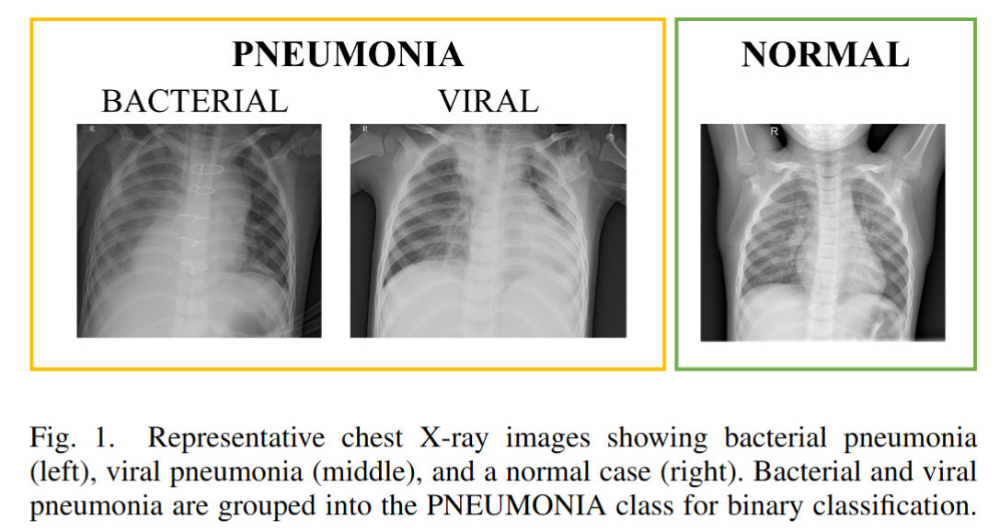

# AIMI2026Fall-LAB1

NYCU CS AIMI Fall 2026 Lab 1: Chest X-ray pneumonia classification using ResNet18, ResNet50, and ResNet101 with and without ImageNet pretraining.

For the full report, see [LAB1_412551030_黃羿寧.pdf](LAB1_412551030_黃羿寧.pdf).

## Classification Overview

Models classify chest X-ray images as **NORMAL** or **PNEUMONIA**. All layers are trained, and the original classification layer is replaced with a two-class linear layer.

## Dataset

Download the [Chest X-Ray Images (Pneumonia) dataset from Kaggle](https://www.kaggle.com/datasets/paultimothymooney/chest-xray-pneumonia).



The original dataset split is used without repartitioning:

| Partition | NORMAL | PNEUMONIA | Total |
|---|---:|---:|---:|
| Training | 1,341 | 3,875 | 5,216 |
| Validation | 8 | 8 | 16 |
| Test | 234 | 390 | 624 |
| Total | 1,583 | 4,273 | 5,856 |

Place the dataset in the repository root:

```text
chest_xray/
  train/
    NORMAL/
    PNEUMONIA/
  val/
    NORMAL/
    PNEUMONIA/
  test/
    NORMAL/
    PNEUMONIA/
```

Dataset reference: Kermany et al., *Cell* (2018). [DOI](https://doi.org/10.1016/j.cell.2018.02.010)

## Installation

Use Python 3.10 or newer. Install a compatible PyTorch/Torchvision pair using the [official installation instructions](https://pytorch.org/get-started/locally/), then install dependencies:

```bash
pip install -r requirements.txt
```

Experiments were conducted on an **NVIDIA GeForce RTX 5070 Ti**. Run all commands from the repository root.

## Training

### ImageNet pretrained models

```bash
python train.py --models resnet18 resnet50 resnet101 --val-source provided --epochs 20 --batch-size 32 --lr 1e-4 --weight-decay 1e-4 --image-size 224 --workers 0 --seed 42 --output outputs_pretrained
```

### Models trained from scratch

```bash
python train.py --models resnet18 resnet50 resnet101 --val-source provided --epochs 20 --batch-size 32 --lr 1e-4 --weight-decay 1e-4 --image-size 224 --workers 0 --seed 42 --no-pretrained --output outputs_scratch
```

Output directories must be absent or empty. Pretrained weights are downloaded automatically on first use.

### Training settings

- Input: RGB conversion, 224 × 224 resizing, and ImageNet normalization.
- Training augmentation: rotation ±7°, translation up to 3%, and scaling 0.95–1.05.
- Optimizer: AdamW with cosine learning-rate annealing.
- Loss: class-weighted cross entropy.
- Checkpoint: highest validation pneumonia F1-score; lower validation loss breaks ties.
- Test evaluation: performed using the selected checkpoint.

## Test Results

All metrics are percentages. ✓ indicates ImageNet pretraining; ✗ indicates random initialization. Bold indicates the highest value, and underlining indicates the second-highest distinct value in each metric column.

| Model | Pretrained | Selected Epoch | Accuracy | F1-score | Precision | Recall | Specificity |
|---|:---:|---:|---:|---:|---:|---:|---:|
| ResNet18 | ✓ | 5 | <ins>91.03</ins> | <ins>93.27</ins> | <ins>87.78</ins> | **99.49** | <ins>76.92</ins> |
| ResNet50 | ✓ | 5 | **93.11** | **94.71** | **91.02** | 98.72 | **83.76** |
| ResNet101 | ✓ | 10 | 87.34 | 90.76 | 83.44 | **99.49** | 67.09 |
| ResNet18 | ✗ | 18 | 88.14 | 91.25 | 84.65 | <ins>98.97</ins> | 70.09 |
| ResNet50 | ✗ | 11 | 84.62 | 88.79 | 81.55 | 97.44 | 63.25 |
| ResNet101 | ✗ | 17 | 87.02 | 90.30 | 84.72 | 96.67 | 70.94 |

PNEUMONIA is the positive class.

## Plotting

```bash
jupyter lab
```

Open `plot_resnet_comparison.ipynb` to plot the six models' training and validation accuracy/F1-score. Figures are saved in `comparison_figures/`.

## Evaluation and Grad-CAM

```bash
python inference.py --checkpoint outputs_pretrained/resnet50/best.pt --data-dir ./chest_xray/test

python gradcam.py --checkpoint outputs_pretrained/resnet50/best.pt --data-dir ./chest_xray/test --layer layer4 --target predicted --per-category 3 --output gradcam_results_resnet50
```

Grad-CAM visualizes the predicted class for selected TN, FP, TP, and FN cases.

## Saved Outputs

Each experiment saves its configuration, training log, and comparison results. Each model folder contains:

- `best.pt`: selected checkpoint.
- `history.csv`: training and validation metrics.
- `test_metrics.json`: final test metrics.
- `test_confusion_matrix.png`: test confusion matrix.

A fixed seed of 42 is used. Exact results may vary across software and hardware versions. To record the original training environment:

```bash
python -m pip freeze > requirements-lock.txt
```